Many of our products come with a MakeCode **extension**: a bundle of extra blocks that lets your micro:bit talk to the hardware. Our extensions live on GitHub, so rather than finding them in a list, you add them by pasting in their web address. It only takes a minute, and you only need to do it once per project.

## Which of our products have an extension?

Look for the orange **Makecode** ribbon across the top-right corner of a tile in our [catalog](../../catalog/). Every product with that ribbon has an extension you can load into MakeCode using this guide.

    

        <x-tile>
            

            Makecode
            <h3 class="text-lg font-semibold mb-1 text-center">Example product</h3>
            
Look for the ribbon in the corner.

        </x-tile>
    

Once you open a product page, extensions also show a box near the top that starts *"Use this extension in MakeCode"*, containing the address you'll need. Products without the ribbon don't have a MakeCode extension. They might be hardware that needs no extra blocks, or software for other tools.

## Before you start

You will need:

- A web browser, and access to [MakeCode for micro:bit](https://makecode.microbit.org/).
- The extension's GitHub address. You'll find this near the top of each product page on our site, in a box that starts *"Use this extension in MakeCode"*. It looks something like this:

  <code>https://github.com/tuxie-tech/pxt-haptibit.git</code><button type="button" class="copy-button" title="Copy to clipboard" aria-label="Copy code to clipboard"></button>

  Click the copy button next to the address to put it on your clipboard.

## Adding the extension

The screenshots below use our [HaptiBit](../../catalog/tuxietech-hapti-bit/) as the example, with the place to click outlined in orange. Other extensions work in exactly the same way; only the name and the blocks change.

### Step 1: Open a project

Go to [makecode.microbit.org](https://makecode.microbit.org/) and click **New Project**. If you already have a project you want to add the extension to, click that instead and skip ahead to step 2.

<figure class="screenshot">
    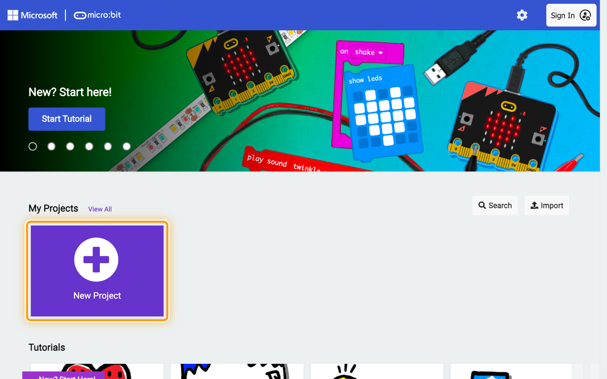
    <figcaption>On the MakeCode home page, click <strong>New Project</strong>.</figcaption>
</figure>

Give your project a name, then click **Create**.

<figure class="screenshot">
    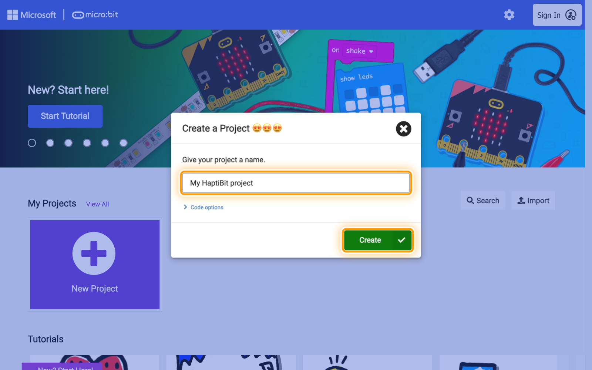
    <figcaption>Type a name, then click <strong>Create</strong>.</figcaption>
</figure>

The first time you open the editor, MakeCode offers a short tour. You can follow it if you like, or close it with the **&times;** in its corner.

<figure class="screenshot">
    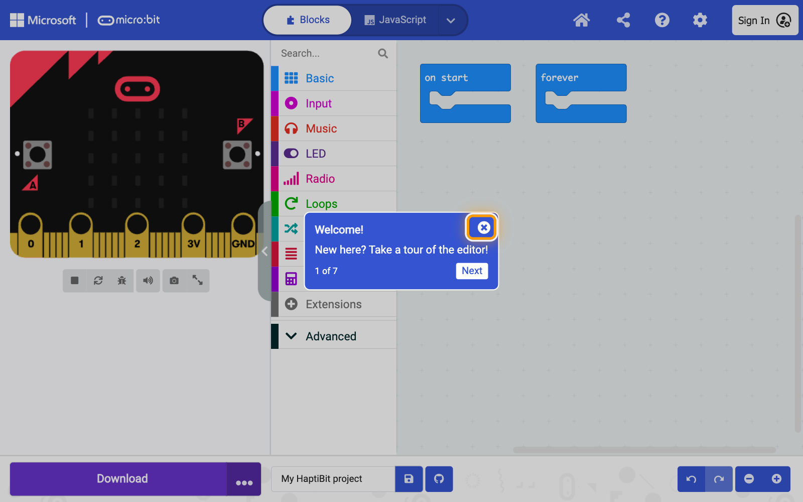
    <figcaption>Close the <em>Welcome!</em> tour, or click <strong>Next</strong> to take it first.</figcaption>
</figure>

### Step 2: Open the Extensions page

In the list of block categories (Basic, Input, Music&hellip;), click **Extensions**, near the bottom.

<figure class="screenshot">
    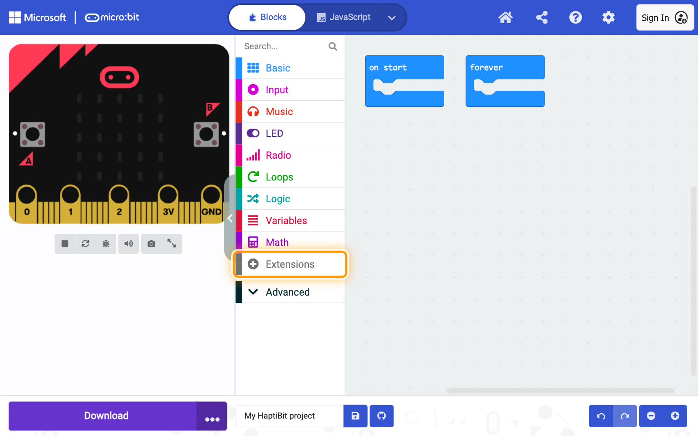
    <figcaption>Click <strong>Extensions</strong> at the bottom of the block categories.</figcaption>
</figure>

You can also get there from the **gear** menu at the top right of the editor.

<figure class="screenshot">
    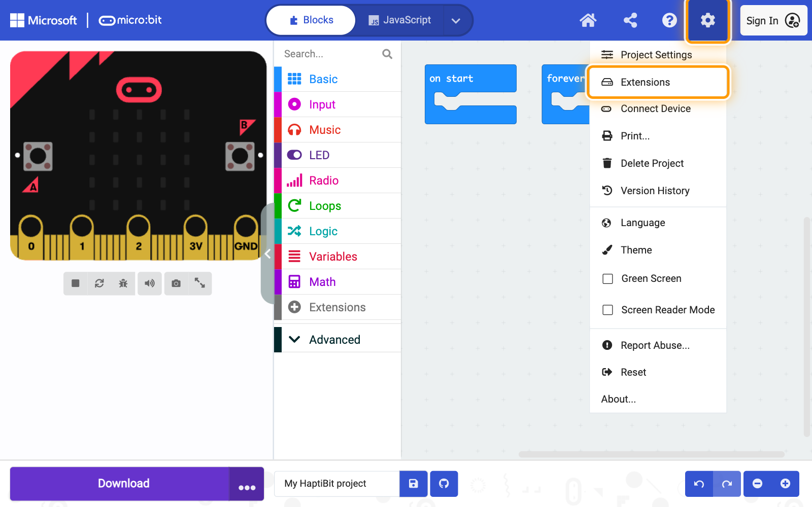
    <figcaption>Or open the <strong>gear</strong> menu and choose <strong>Extensions</strong>.</figcaption>
</figure>

### Step 3: Paste the address

Click in the search box at the top of the Extensions page, which says *Search or enter project URL&hellip;*, and paste in the GitHub address: <kbd>Ctrl</kbd>+<kbd>V</kbd>, or <kbd>&#8984;</kbd>+<kbd>V</kbd> on a Mac. Then press <kbd>Enter</kbd>, or click the magnifying glass.

<figure class="screenshot">
    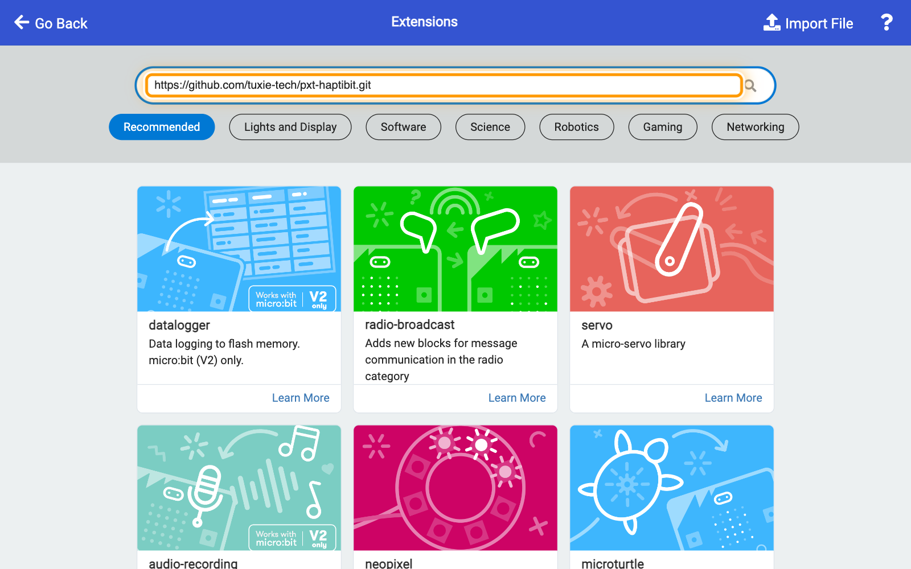
    <figcaption>Paste the address into the search box and press <kbd>Enter</kbd>.</figcaption>
</figure>

### Step 4: Choose the extension

A single tile for the extension appears under **Search Results**. Click it.

The tile says *"User-provided extension, not endorsed by Microsoft"*. MakeCode says this about every extension that comes from GitHub rather than its own built-in list, including all of ours, so it's nothing to worry about.

<figure class="screenshot">
    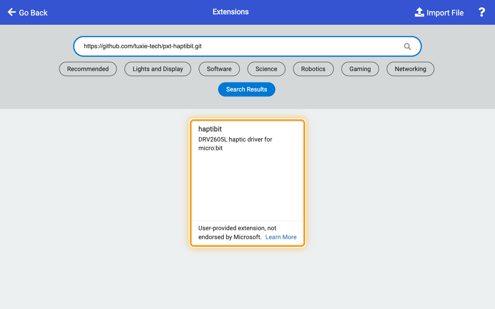
    <figcaption>Click the extension&rsquo;s tile to add it to your project.</figcaption>
</figure>

### Step 5: Find your new blocks

MakeCode takes you straight back to the editor, and a new block category, named after the product, appears just above **Extensions**.

<figure class="screenshot">
    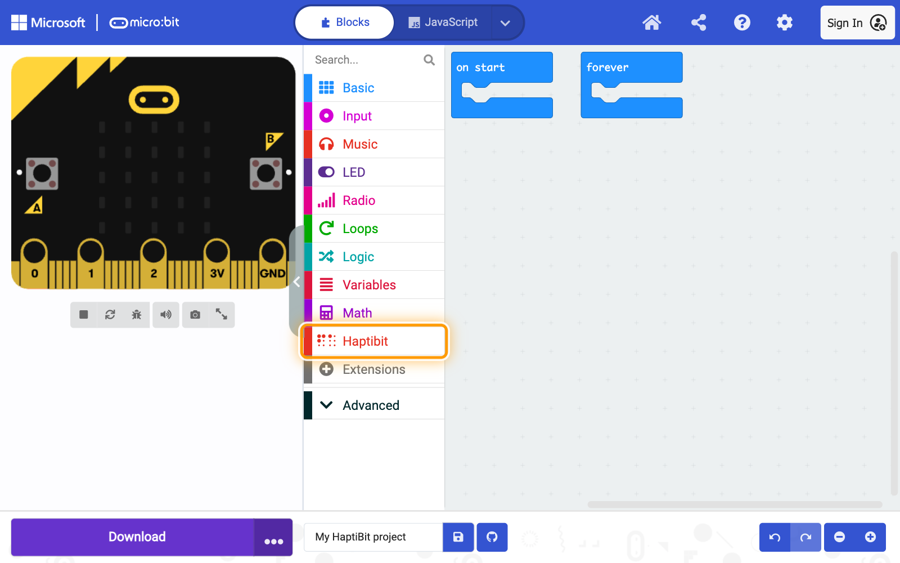
    <figcaption>The new category appears in the block list.</figcaption>
</figure>

Click it to see the new blocks, then drag them into your program just like any other block.

<figure class="screenshot">
    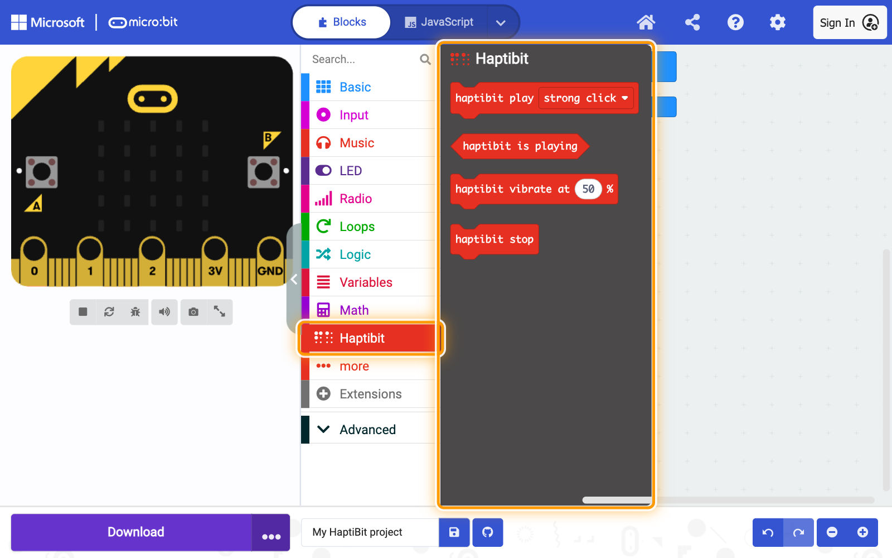
    <figcaption>The extension&rsquo;s blocks, ready to drag into your program.</figcaption>
</figure>

That's it. The extension is saved as part of your project, so it will still be there next time you open it, and anyone you share the project with gets it too.

## Using JavaScript or Python instead of blocks

Extensions work in all three of MakeCode's editors. Once the extension is added, switch to **JavaScript** or **Python** using the toggle at the top of the editor, and the extension's functions are available there as well. The product's own documentation pages list them.

## Removing an extension

If you added the wrong one, or no longer need it, first remove any of its blocks from your program, because they will stop working once the extension is gone. Then:

1. Switch to **JavaScript** using the toggle at the top of the editor. The **Explorer** panel only appears below the simulator in the JavaScript and Python views.
2. Click **Explorer** to expand it.

<figure class="screenshot">
    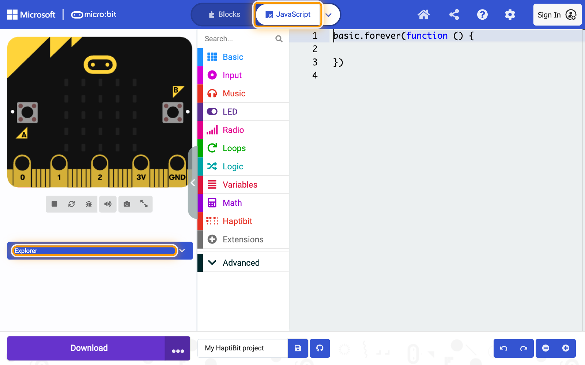
    <figcaption>Switch to <strong>JavaScript</strong>, then open <strong>Explorer</strong>.</figcaption>
</figure>

3. Scroll down the list to the extension, and click the **bin** icon on its row.

<figure class="screenshot">
    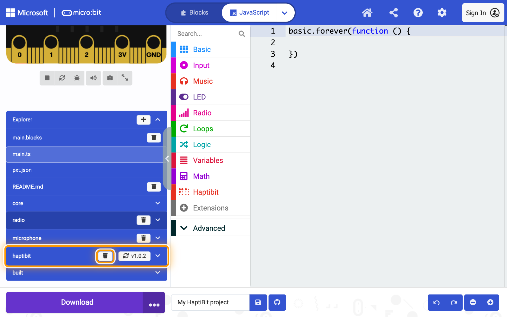
    <figcaption>Click the <strong>bin</strong> next to the extension to remove it.</figcaption>
</figure>

You can then switch back to **Blocks**.

## Troubleshooting

**Nothing appears when I search.**
Check that you pasted the *whole* address, starting with `https://`, and that nothing extra (like a space or a full stop) was copied at either end.

**I see "this site can't be reached" or the search hangs.**
Some school and workplace networks block GitHub. MakeCode needs to reach `github.com` to download the extension the first time. Ask your IT team whether GitHub can be allowed, or add the extension once on a different network: after that it is saved inside the project.

**The extension added, but I can't see the new category.**
New categories appear just above **Extensions** in the block list. If the list is long, scroll down, or type the product name into the **Search&hellip;** box at the top of the block list.

**I'm using the offline MakeCode app.**
The app can add GitHub extensions in the same way, but it needs an internet connection while you add them.

**Still stuck?**
Email us at <a href="mailto:john@tuxie.tech?subject=Help%20loading%20a%20MakeCode%20extension">john@tuxie.tech</a> and tell us which product you're using and what you see. A screenshot helps a lot.
